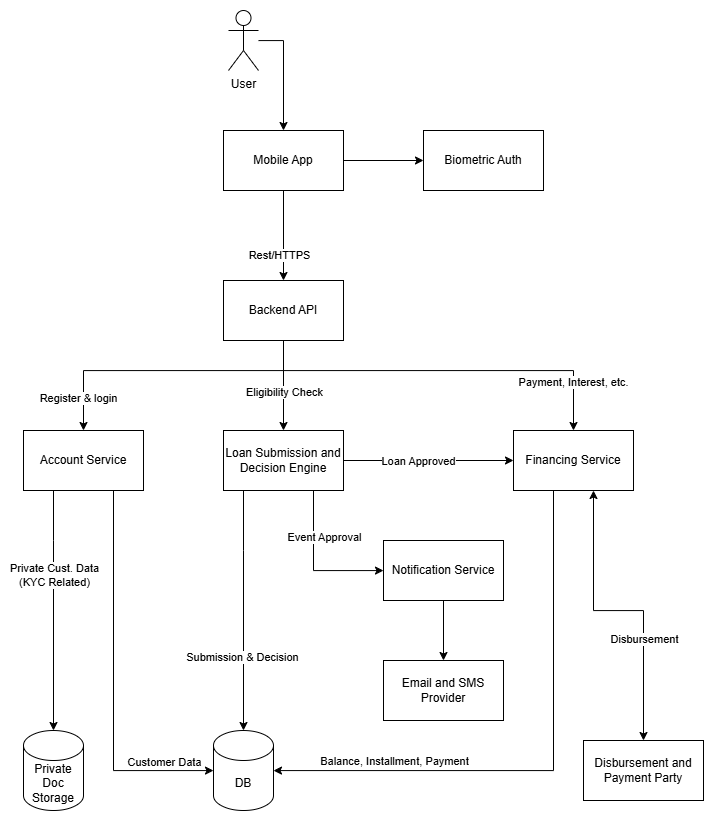
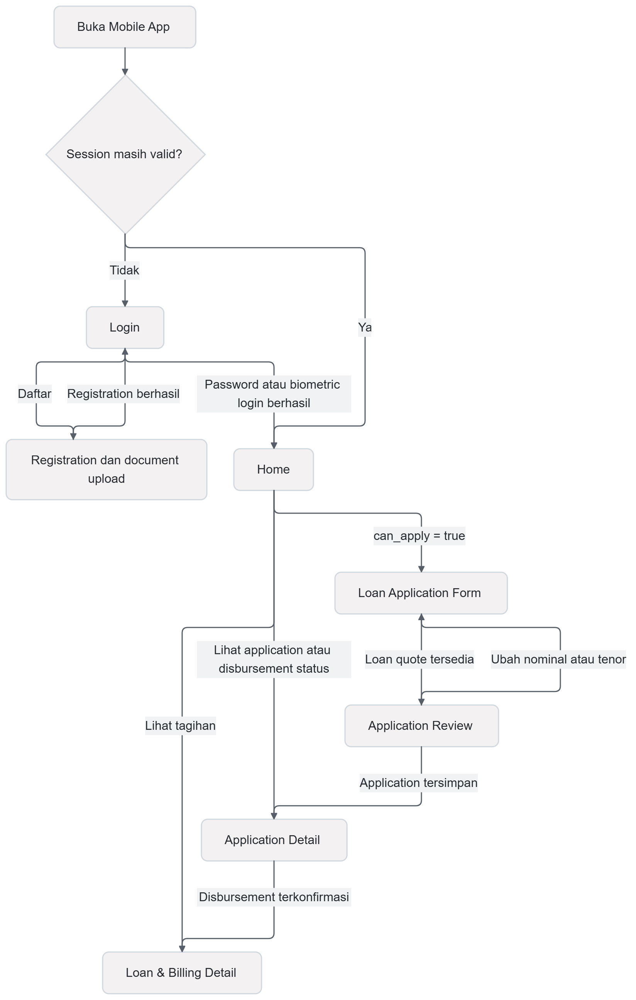
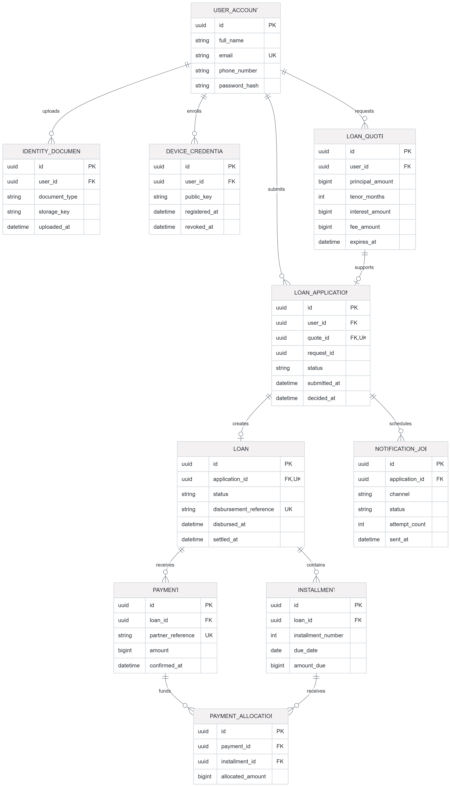
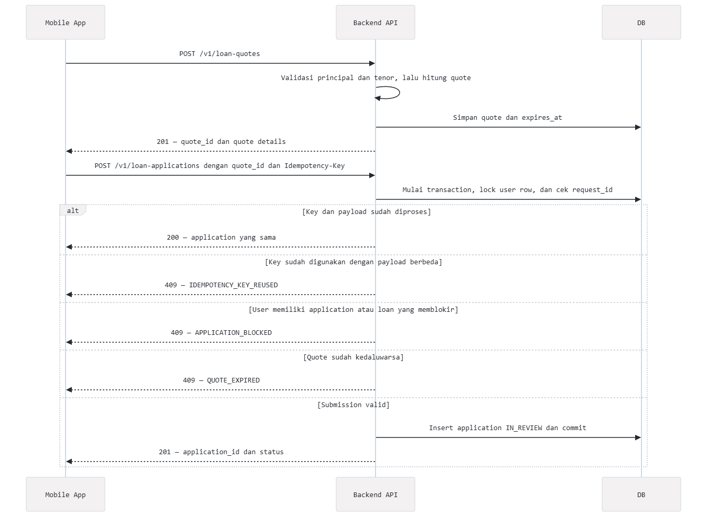

# Mobile Fintech App Design

## Requirement

PT. XYZ adalah sebuah perusahaan fintech yang ingin mengembangkan mobile apps mereka, dalam upaya menjangkau pengguna yang lebih luas mereka ingin mengembakan aplikasi pinjaman online.

### Potential High Level User Story

- User melakukan registrasi dengan data diri, email, nomor telepon dan upload foto beserta KTP
- User dapat login dengan password atau biometric (jika ada di perangkat mobilenya)
- User dapat melihat Sisa hutang dan tagihan perbulan yang harus di bayarkan (Jika ada)
- User dapat meminjam uang paling besar Rp. 12.000.000 dengan tenor maksimal 1 taun.
- User dalam proses peminjaman akan di proses dengan hasil diterima atau ditolak
- Jika pinjaman diterima maka akan ada notifikasi lewat email dan nomot telepon yang terdaftar
- User tidak dapat melakukan peminjaman uang jika sedang ada proses peminjaman dan belum di lunaskan.

## High Level Architecture & Design

### Technical Description

1. **Mobile App**. User menggunakan Mobile App untuk registrasi, login, submit loan application, memantau application status, dan melihat outstanding balance serta tagihan bulanan. Mobile App berkomunikasi dengan Backend API melalui REST over HTTPS.

2. **Biometric Auth**. Mobile App menggunakan fitur biometrik perangkat sebagai opsi login setelah user mengaktifkannya. Jika biometrik tidak tersedia, user dapat login dengan password.

3. **Backend API** Menjadi entry point untuk request dari Mobile App. Backend API meneruskan registrasi dan login ke Account Service, eligibility check dan pengajuan ke Loan Submission and Decision Engine, serta request terkait saldo, cicilan, bunga, dan pembayaran ke Financing Service.

4. **Account Service** menangani registrasi dan login. Service ini menyimpan data akun seperti email dan nomor telepon di DB, serta menyimpan foto diri dan KTP di Private Doc Storage.

5. **Loan Submission and Decision Engine** menjalankan eligibility check, memvalidasi nominal maksimal Rp12.000.000 dan tenor maksimal 12 bulan, lalu menyimpan pengajuan dan hasil keputusan di DB. Pengajuan baru diblokir jika ada pengajuan yang masih diproses atau pinjaman yang menunggu pencairan maupun belum lunas. Jika disetujui, engine meneruskan hasil approval ke Financing Service dan menerbitkan approval event untuk Notification Service.

6. **Financing Service** menangani loan yang sudah disetujui dan berintegrasi dengan Disbursement and Payment Party untuk pencairan dan konfirmasi pembayaran. Setelah pencairan terkonfirmasi, service ini mengaktifkan loan dan membuat installment schedule. Service ini juga memperbarui outstanding balance dan status cicilan setelah pembayaran terkonfirmasi.

7. **Notification Service** menerima approval event dari Loan Submission and Decision Engine dan menggunakan Email and SMS Provider untuk mengirim notifikasi persetujuan ke email dan nomor telepon user yang terdaftar.

8. **Private Doc Storage** menyimpan dokumen identitas yang diunggah saat registrasi, seperti foto diri dan KTP. DB menyimpan referensi file yang digunakan oleh Account Service.

9. **Database (DB)** Menyimpan data akun dari Account Service, data pengajuan dan keputusan dari Loan Submission and Decision Engine, serta data saldo, cicilan, dan pembayaran dari Financing Service.

## App Screen Flow & Description

1. Saat Mobile App dibuka, user langsung masuk ke Home jika session masih valid. Jika session sudah expired, app membuka Login.

2. User baru masuk ke Registration, mengisi data diri, lalu upload selfie dan foto KTP. Setelah account berhasil dibuat, user kembali ke Login. Biometric login tersedia setelah user mengaktifkannya pada perangkat yang mendukung.

3. Home menampilkan tombol Ajukan pinjaman saat backend mengembalikan `can_apply = true`. Jika application masih `IN_REVIEW` atau loan masih `PENDING_DISBURSEMENT`, tombol utama membuka Application Detail. Jika loan sudah `ACTIVE`, tombol utama membuka Loan & Billing Detail.

4. Di Loan Application Form, user mengisi nominal dan tenor. Setelah backend mengembalikan loan quote, user bisa cek interest, fee, estimasi installment, dan total repayment di Application Review. User bisa ubah isian atau lanjut submit.

5. Setelah submission tersimpan, app membuka Application Detail. Jika application `APPROVED`, user bisa cek disbursement status. Tombol Lihat tagihan tersedia setelah disbursement terkonfirmasi. User bisa apply lagi setelah application ditolak atau loan lunas, selama `can_apply = true`.

Berikut tabel terkait screen flow untuk halaman Home.

| Status dari backend | Informasi di Home | Primary CTA |
| --- | --- | --- |
| Belum ada application | Loan application tersedia | Ajukan pinjaman |
| Application `IN_REVIEW` | Application sedang ditinjau | Lihat pengajuan |
| Application `REJECTED` | Hasil application terakhir | Ajukan lagi jika `can_apply = true` |
| Loan `PENDING_DISBURSEMENT` | Application disetujui, menunggu disbursement | Lihat status pencairan |
| Loan `ACTIVE` | Outstanding balance, next installment, dan due date | Lihat tagihan |
| Loan `SETTLED` | Loan terakhir sudah lunas | Ajukan pinjaman jika `can_apply = true` |

## Entity Relational Diagram

`PK` adalah primary key, `FK` adalah foreign key, dan `UK` menandai kolom dengan constraint `UNIQUE`.

1. `USER_ACCOUNT` menyimpan data account. Satu user bisa punya beberapa `IDENTITY_DOCUMENT` dan `DEVICE_CREDENTIAL`. Dokumen menyimpan `storage_key` yang mengarah ke file di Private Doc Storage. Device credential menyimpan public key untuk biometric login.

2. `LOAN_QUOTE` menyimpan nominal, tenor, interest, fee, dan expiry. Satu quote hanya bisa dipakai untuk satu `LOAN_APPLICATION`. Kombinasi `(user_id, request_id)` dibuat unik supaya retry submit tetap merujuk ke application yang sama.

3. `LOAN_APPLICATION` menyimpan submission dan decision. Application yang `APPROVED` menghasilkan satu `LOAN` dan dua `NOTIFICATION_JOB`, masing-masing untuk email dan SMS.

4. `LOAN` menyimpan status pinjaman. Setelah disbursement terkonfirmasi, Financing Service membuat record `INSTALLMENT` sesuai jadwal cicilan. Setiap installment punya amount dan due date.

5. `PAYMENT_ALLOCATION` mencatat berapa rupiah dari satu `PAYMENT` yang masuk ke tiap installment. Satu payment bisa membayar sebagian satu installment atau beberapa installment sekaligus. Outstanding balance dihitung dari total sisa seluruh installment, sedangkan next installment diambil dari installment tertua yang masih punya saldo.

## API Design

### Mobile API

Endpoint setelah login menggunakan session token. Backend mengambil `user_id` dari token untuk memeriksa ownership setiap quote, application, dan loan. Seluruh monetary amount menggunakan integer dalam rupiah.

| Method dan endpoint | Request utama | Respons berhasil |
| --- | --- | --- |
| `POST /v1/registration-sessions` | Buat sesi unggah sementara | `201` dengan `registration_id`, token registrasi, dan `expires_at` |
| `PUT /v1/registration-sessions/{id}/documents/{type}` | Token registrasi dan file `multipart/form-data`. Tipe `SELFIE` atau `KTP` | `200` dengan status unggahan untuk tipe tersebut. Retry mengganti unggahan pada tipe yang sama. |
| `POST /v1/registration-sessions/{id}/complete` | Token registrasi, data diri, email, nomor telepon, dan password | `201` dengan `user_id` setelah kedua dokumen tersedia dan akun tersimpan |
| `POST /v1/auth/password/login` | `email`, `password` | `200` dengan token sesi |
| `POST /v1/auth/biometric/credentials` | Sesi dari login password yang masih baru dan `public_key` | `201` dengan `credential_id` |
| `POST /v1/auth/biometric/challenges` | `credential_id` | `200` dengan `challenge_id`, challenge sekali pakai, dan `expires_at` |
| `POST /v1/auth/biometric/login` | `credential_id`, `challenge_id`, `signature` | `200` dengan token sesi setelah backend memverifikasi tanda tangan dan memakai challenge secara atomik |
| `GET /v1/home` | Token sesi | `200` dengan `can_apply`, `block_reason`, ringkasan pengajuan, dan ringkasan pinjaman jika ada |
| `POST /v1/loan-quotes` | `principal_amount`, `tenor_months` | `201` dengan `quote_id`, rincian bunga dan biaya, estimasi cicilan, total pembayaran, dan `expires_at` |
| `POST /v1/loan-applications` | Body `quote_id` dan header `Idempotency-Key` | `201` dengan `application_id` dan `IN_REVIEW`. Pengiriman ulang dengan key dan payload yang sama mengembalikan pengajuan tersebut dengan `200`. |
| `GET /v1/loan-applications/{id}` | ID pengajuan | `200` dengan status, rincian yang diajukan, keputusan bila ada, dan status pinjaman terkait |
| `GET /v1/loans/{id}` | ID pinjaman | `200` dengan status, `outstanding_amount`, `next_installment`, dan `installments[]` |

### Loan Submission Sequence Diagram

1. Saat user menekan Lanjut, Mobile App memanggil `POST /v1/loan-quotes`. Backend memvalidasi nominal maksimal Rp12.000.000 dan tenor maksimal 12 bulan, lalu mengembalikan `quote_id`, rincian biaya, dan `expires_at`.

2. Saat user menekan Kirim pengajuan, Mobile App mengirim `quote_id` dan header `Idempotency-Key` ke `POST /v1/loan-applications`.

3. Backend mengambil row lock per user sebelum mengecek request yang pernah diproses dan eligibility. Jika key dan payload sama, backend mengembalikan application yang sudah tersimpan dengan 200. Jika key sama dipakai untuk payload berbeda, backend mengembalikan 409 `IDEMPOTENCY_KEY_REUSED`.

4. Untuk request baru, backend mengembalikan 409 `APPLICATION_BLOCKED` jika masih ada application atau loan yang memblokir. Jika quote sudah expired, backend mengembalikan 409 `QUOTE_EXPIRED` dan app meminta user review quote baru sebelum submit lagi.

5. Jika semua check lolos, backend menyimpan application sebagai `IN_REVIEW` lalu mengembalikan 201 dan `application_id`. Mobile App membuka Application Detail. Jika response terputus setelah submit, app memakai key yang sama saat retry supaya application tidak tercatat dua kali.

## Mobile App Screen Behavior

### Asumsi

- Rp1 dan satu bulan di set sebagai technical lower bounds.
- Interest, fee, dan installment rounding mengikuti product configuration.
- SMS digunakan sebagai notification channel ke nomor telepon terdaftar.
- Disbursement dan payment confirmation berasal dari external partner.

| Screen | Primary behavior | Loading, error, dan recovery |
| --- | --- | --- |
| Registration | Tampilkan personal data form dan dua document slot untuk selfie dan KTP. Setiap slot punya preview, upload status, dan aksi ganti foto. Aktifkan **Daftar** setelah form valid dan kedua upload selesai. Buka **Login** setelah account dibuat. | Tampilkan upload progress per slot. Retry hanya file yang gagal dan pertahankan form input. Jika upload session expired, buat session baru dan tandai dokumen yang perlu diunggah kembali. |
| Login | Gunakan email dan password. Setelah password login berhasil, tawarkan biometric enrollment pada perangkat yang mendukung. Tampilkan opsi biometric login pada sesi berikutnya jika `credential_id` tersedia. | Saat authentication berjalan, tampilkan loading state. Jika biometric prompt dibatalkan atau gagal, user bisa melanjutkan dengan password. Saat session expired, arahkan ke **Login**, lalu reload **Home**. |
| Home | Fetch `GET /v1/home` setelah login dan saat user kembali dari screen detail. Render summary dan primary CTA berdasarkan status serta `can_apply`. | Tampilkan loading placeholder saat initial fetch dan aktifkan CTA pengajuan setelah eligibility tersedia. Jika fetch gagal, tampilkan **Coba lagi**. Saat refresh berhasil, update summary dan CTA dari response yang sama. |
| Loan Application Form | Tampilkan currency input dalam rupiah, batas principal, dan pilihan tenor. Tombol **Lanjut** meminta loan quote lalu membuka **Application Review**. | Tampilkan inline validation error pada field terkait. Pertahankan input jika request quote gagal atau user kembali dari review. |
| Application Review | Tampilkan principal, tenor, interest, fee, estimated installment, dan total repayment. Tombol **Ubah** kembali ke form. Tombol **Kirim pengajuan** submit `quote_id` yang sedang ditampilkan. | Disable tombol saat request masih in flight. Jika response terputus, tampilkan **Sedang mengecek pengajuan** dan gunakan key yang sama saat retry. Untuk `QUOTE_EXPIRED`, ambil quote baru dan minta user review ulang. Untuk `APPLICATION_BLOCKED`, arahkan ke detail resource yang memblokir. |
| Application Detail | Tampilkan application ID, submission date, principal, tenor, dan decision status. Untuk `APPROVED`, tampilkan disbursement status. Aktifkan **Lihat tagihan** setelah disbursement terkonfirmasi. | Refresh saat screen dibuka kembali. Jika refresh gagal dan data sebelumnya tersedia, pertahankan status terakhir dan tampilkan **Coba lagi**. |
| Loan & Billing Detail | Tampilkan outstanding balance dan next installment sebagai dua angka terpisah. Tampilkan installment schedule dengan amount, remaining amount, due date, dan payment status. Untuk `SETTLED`, tampilkan **Lunas**. | Bedakan installment yang partially paid dari installment yang overdue. Setelah payment terkonfirmasi, refresh balance dan schedule dari response yang sama. Saat loan `SETTLED`, hilangkan kartu next installment dan refresh eligibility saat user kembali ke **Home**. |
